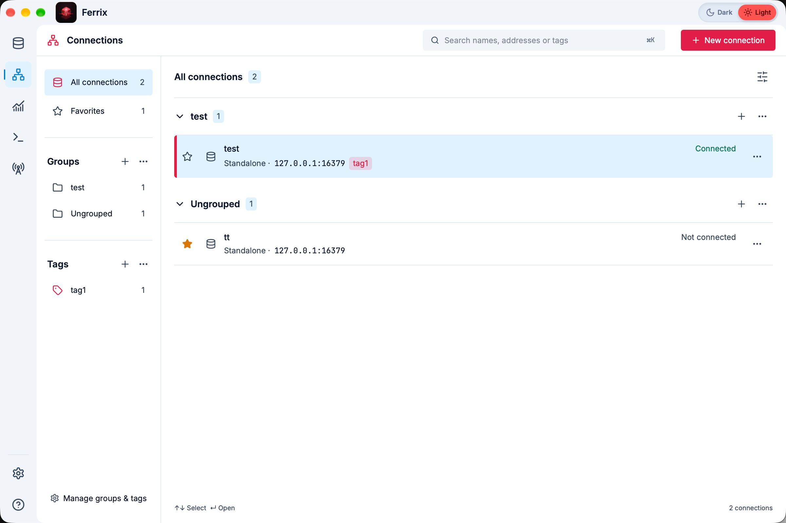
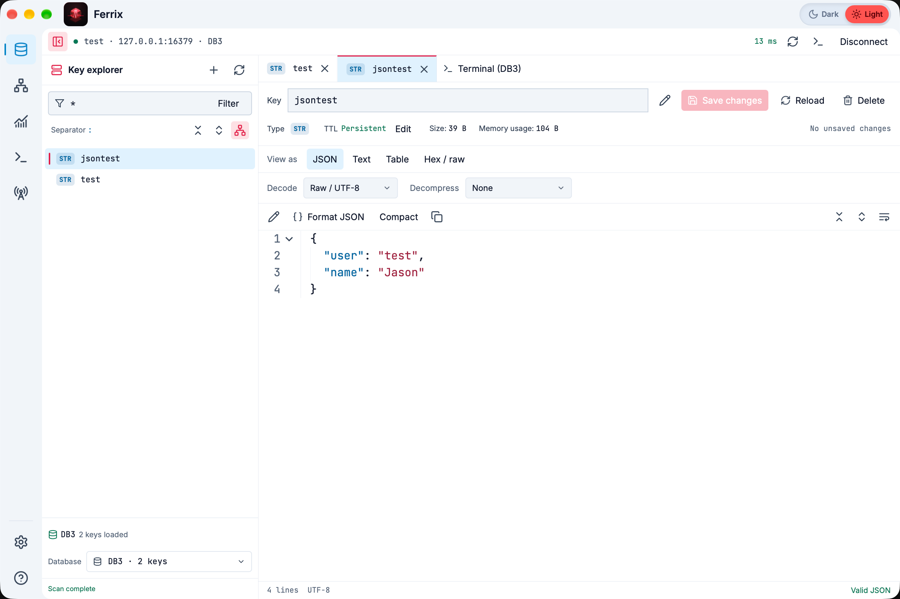
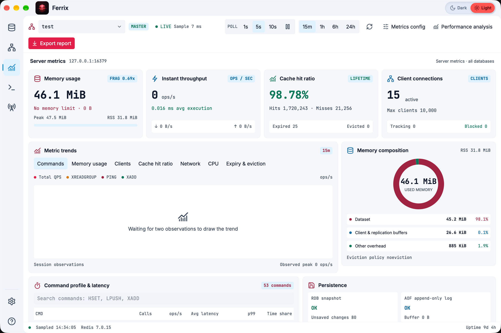

# Ferrix

Ferrix is a native Redis desktop client built with [nsh](https://nsh.dev) mixed mode:
a Rust core and a TSX interface in one repository. The target platforms are macOS,
Windows and Linux; local platform verification runs on macOS.

The app opens a native, resizable Redis workspace with dark/light themes, key
search, tabs, a folding JSON editor and an example console. The window currently
uses clearly labeled local example data. The Rust core implements typed Redis
operations; connecting those operations to the window is a separate integration.

## Screenshots

### Connections



### Key explorer



### Server monitoring



## Development

Use the nsh 0.6.0 stable CLI to match the `nsh-*` dependencies pinned in
`Cargo.lock`. Check the installed version with `nsh --version`.

```sh
nsh run --target macos       # run the native macOS app with hot reload
nsh run --target windows     # run the native Windows app with hot reload
nsh check                    # check Rust and TSX against generated native declarations
nsh test                     # run Rust tests and discover headless UI tests
nsh test --target macos      # run UI tests in the native macOS host
cargo fmt -- --check         # check Rust formatting
nsh package --target macos   # desktop package; also supports linux and windows
```

`nsh check` is the lint/type gate. TSX changes hot-update the running app;
Rust changes rebuild and restart it.

The sidebar's Help page shows application identity from NSH's `appInfo()`, so
version and build follow `nsh.json` and package-time overrides. Project URLs and
the included build notes live in `src/pages/help/help-content.ts`, with English and Chinese
copy in `locales/`. Project and feedback links open in the system browser.
