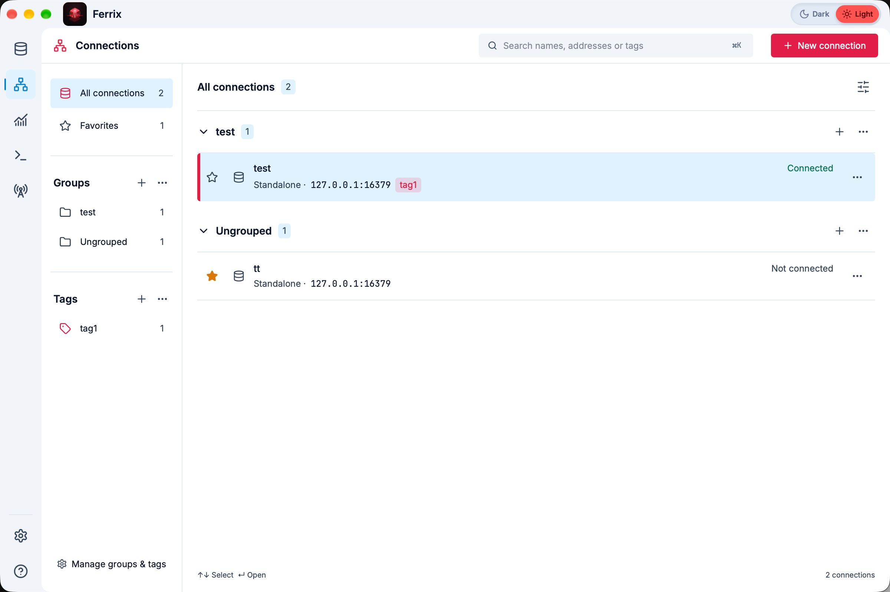
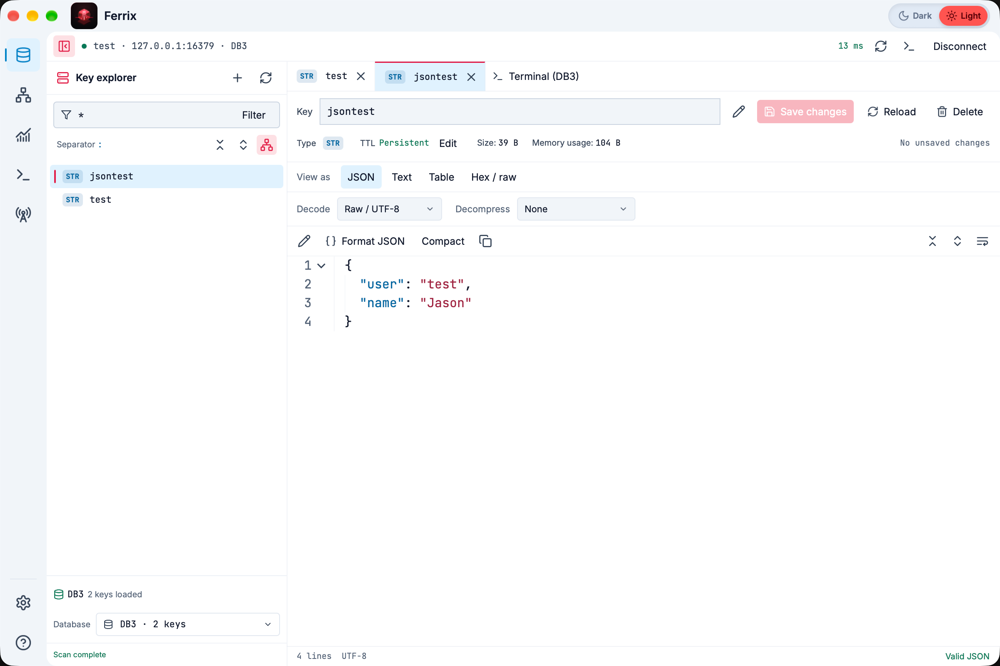
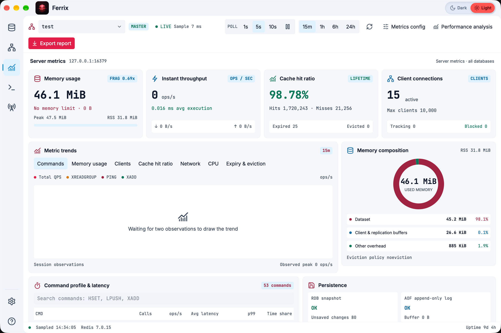

# Ferrix

[English](README.md)

Ferrix 是一个原生 Redis 桌面客户端，面向 macOS、Windows 和 Linux。它使用 nsh 混合模式，在同一个仓库中维护 Rust 核心和 TSX 界面。 [nsh 文档](https://nsh.dev)

Ferrix 支持 Redis 单机、集群和 Sentinel 连接。工作区可以调整大小，提供深色和浅色主题、键搜索、多标签页、可折叠的 JSON 编辑器和 Redis 控制台。

## 截图

### 连接中心



### 键浏览器



### 服务器监控



## 开发

使用 nsh 0.6.1 稳定版 CLI，与 `Cargo.lock` 中锁定的 `nsh-*` 依赖保持一致。可以用 `nsh --version` 查看本地版本。

```sh
nsh run --target macos       # 启动 macOS 原生应用，支持热重载
nsh run --target windows     # 启动 Windows 原生应用，支持热重载
nsh check                   # 检查 Rust，并根据生成的原生接口声明检查 TSX
nsh test                    # 运行 Rust 测试并自动查找无头 UI 测试
nsh test --target macos      # 在 macOS 原生环境中运行 UI 测试
cargo fmt -- --check        # 检查 Rust 代码格式
nsh package --target macos   # 打包桌面应用，也支持 linux 和 windows
```

`nsh check` 负责代码和类型检查。修改 TSX 会热更新运行中的应用，修改 Rust 会触发重新编译并重启应用。

侧栏的「帮助」页显示应用信息。NSH 的 `appInfo()` 从 `nsh.json` 和打包时的覆盖参数获取版本和构建信息。内置版本亮点定义在 `src/pages/help/help-content.ts`，中英文文案放在 `locales/`。项目和反馈链接在系统浏览器中打开。

发布前先在 `CHANGES.md` 写好更新说明，再创建版本标签。发布流程会用同一份内容生成应用内更新说明和 GitHub Release 正文。 [CHANGES.md](CHANGES.md)
